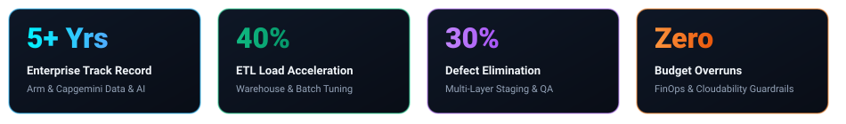
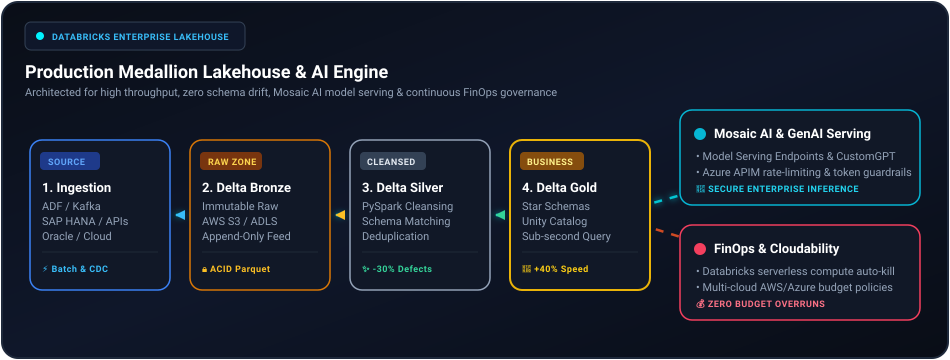

<!-- ================================================================= -->
<!-- SAM HAKKE | ENTERPRISE DATA & ANALYTICS PLATFORM SPECIALIST       -->
<!-- GitHub Landing Page & Interactive Portfolio README                -->
<!-- ================================================================= -->

<div align="center">

  <!-- Dynamic Animated Waving Header Banner -->
  

  <!-- Animated Typing Headline -->
  <a href="https://sameerhakke.netlify.app/">
    
  </a>

  <br/>

  <!-- Interactive Quick-Action Badges -->
  <p align="center">
    <a href="https://sameerhakke.netlify.app/" target="_blank">
      
    </a>
    <a href="https://sameerhakke.netlify.app/resume.html" target="_blank">
      
    </a>
    <a href="https://www.linkedin.com/in/sameer-hakke-8b40401ab" target="_blank">
      
    </a>
    <a href="mailto:sameerhakke10@gmail.com">
      
    </a>
    <a href="https://github.com/SamHakke/portfolio/stargazers">
      
    </a>
  </p>

  <!-- Glowing Rainbow / Tech Divider Line -->
  

</div>

<br/>

## 👨‍💻 Executive Summary

> *"Bridging resilient multi-cloud lakehouse architecture, scalable GenAI model serving, and zero-waste FinOps economics."*

I am a **Data & Analytics Platform Specialist at Arm** (formerly Senior Software Engineer at **Capgemini**) with **5+ years of enterprise experience** architecting, operating, and governing mission-critical data platforms across **AWS, Azure, and Databricks**.

Applying the **AWS & Azure Well-Architected Frameworks**, I specialize in designing high-throughput **Medallion Lakehouses (Bronze → Silver → Gold)**, scaling secure **Mosaic AI & CustomGPT** inference gateways, automating cross-cloud **CI/CD with Terraform & Azure DevOps**, and enforcing real-time **FinOps cloud cost governance** via IBM Cloudability.

<div align="center">
  <table border="0">
    <tr>
      <td width="30%" align="center" valign="middle">
        <a href="https://sameerhakke.netlify.app/">
          
        </a>
        <br/>
        <b>Sameer Hakke</b><br/>
        <sub>Bengaluru, Karnataka, India</sub><br/>
        <a href="https://sameerhakke.netlify.app/"></a>
      </td>
      <td width="70%" valign="top">
        <h3>🎯 Core Specializations</h3>
        <ul>
          <li><b>Enterprise Lakehouse Architecture:</b> Databricks Unity Catalog, Delta Lake Liquid Clustering, Autoloader, and ACID reliability.</li>
          <li><b>Multi-Cloud Data Infrastructure:</b> AWS (S3, IAM, CloudWatch) &amp; Azure (ADF, APIM, ADLS Gen2, Virtual Networks).</li>
          <li><b>Enterprise GenAI &amp; Model Serving:</b> Databricks Mosaic AI endpoints, OpenAI CustomGPT integration, and Azure APIM rate-limiting.</li>
          <li><b>FinOps &amp; Cloud Economics:</b> IBM Cloudability, serverless 15-minute compute auto-shutdown policies, and zero budget overruns.</li>
          <li><b>Data Warehousing &amp; Optimization:</b> SAP HANA, Oracle Database, PL/SQL tuning, and -40% batch execution reduction.</li>
        </ul>
      </td>
    </tr>
  </table>
</div>

<br/>

<!-- ================================================================= -->
<!-- ENTERPRISE METRICS RIBBON                                         -->
<!-- ================================================================= -->

<div align="center">
  <h3>⚡ Enterprise Impact &amp; Platform Metrics</h3>
  
</div>

<br/>

<!-- ================================================================= -->
<!-- LIVE TERMINAL TELEMETRY                                           -->
<!-- ================================================================= -->

<div align="center">
  <h3>💻 Live Platform Telemetry &amp; Runtime Status</h3>
  
</div>

<br/>

<!-- ================================================================= -->
<!-- INTERACTIVE MEDALLION ARCHITECTURE SHOWCASE                       -->
<!-- ================================================================= -->

## 🏛️ Interactive Medallion Lakehouse & AI Architecture

Below is the production data topology engineered to handle multi-terabyte batch & CDC streaming datasets while guaranteeing sub-second BI query latencies, auditable data lineage, and audited GenAI access.

<div align="center">
  
</div>

<br/>

<details open>
<summary><b>🔍 Click to expand: Architectural Tier Breakdown</b></summary>
<br/>

| Tier | Name | Technology Stack | Key Achievements & Engineering SLA |
| :--- | :--- | :--- | :--- |
| **01** | **Hybrid Ingestion** | Azure Data Factory, Kafka, EventHub, REST APIs | Self-hosted IR connectivity between on-prem SAP/Oracle & cloud endpoints; standardized parameter-driven CDC templates. |
| **02** | **Delta Bronze** | Delta Lake, AWS S3, ADLS Gen2, Databricks Autoloader | Raw immutable append-only ingestion with ACID transaction logs; zero schema-drift pipeline failures. |
| **03** | **Delta Silver** | PySpark, Staging Warehouses, PL/SQL, Data Quality Rules | Multi-layer cleansing, deduplication, and schema validation. **Reduced downstream data discrepancies by 30%**. |
| **04** | **Delta Gold** | SAP HANA, SQL Server, Star Schemas, Power BI / OneLake | Decommissioned legacy SAP BO/BODS; delivered sub-second query latency for executive dashboards with **40% faster target loading**. |
| **05** | **Mosaic AI Serving**| Databricks Mosaic AI, Azure APIM, OpenAI CustomGPT | Scalable ML model serving with enterprise token quotas, rate limiting, and private endpoint credential isolation. |
| **06** | **FinOps Economics** | IBM Cloudability, Serverless Policies, AWS/Azure Budgets | 15-minute idle compute auto-termination; automated alerts for runaway ML experimentation; **Zero budget overruns**. |

</details>

<br/>

<!-- ================================================================= -->
<!-- TECH STACK & ECOSYSTEM MATRIX                                     -->
<!-- ================================================================= -->

## 🛠️ Technology Stack & Ecosystem Matrix

<div align="center">

### ☁️ Cloud & Platform Orchestration
<p>
  
  
  
  
  
</p>

### 🤖 Data Engineering, AI & LLM Infrastructure
<p>
  
  
  
  
  
  
</p>

### 💰 FinOps & Cloud Economics
<p>
  
  
  
  
</p>

### ⚙️ Infrastructure as Code & DevOps
<p>
  
  
  
  
  
</p>

### 🗄️ Relational & Analytical Databases
<p>
  
  
  
  
  
</p>

</div>

<br/>

<!-- ================================================================= -->
<!-- FEATURED PRODUCTION PROJECTS                                      -->
<!-- ================================================================= -->

## 🚀 Featured Architectural Initiatives

<table width="100%">
  <tr>
    <td width="50%" valign="top">
      <h3>🏛️ 1. Enterprise Medallion Lakehouse Platform</h3>
      <p><b>Category:</b> Architecture &amp; Data Platform • <b>Ecosystem:</b> Databricks, AWS S3, Delta Lake, Unity Catalog, Terraform</p>
      <ul>
        <li>Designed end-to-end lakehouse architecture across Bronze, Silver, and Gold layers with Liquid Clustering.</li>
        <li>Unified enterprise governance using Unity Catalog for column/row level access controls.</li>
        <li><b>Impact:</b> Slashing query latency by 50% and democratized self-serve data for 50+ engineers &amp; scientists.</li>
      </ul>
      <a href="https://sameerhakke.netlify.app/#architecture"></a>
    </td>
    <td width="50%" valign="top">
      <h3>💰 2. FinOps Cloud Cost &amp; Serverless Governance</h3>
      <p><b>Category:</b> FinOps &amp; Cloud Economics • <b>Ecosystem:</b> IBM Cloudability, AWS, Azure, Serverless Compute</p>
      <ul>
        <li>Configured cross-cloud cost attribution dashboards mapping compute spend directly to project value.</li>
        <li>Implemented automated auto-termination policies for idle serverless compute (15-minute cutoffs).</li>
        <li><b>Impact:</b> Prevented runaway GenAI compute expenses and maintained 100% executive budget transparency.</li>
      </ul>
      <a href="https://sameerhakke.netlify.app/#finops-spotlight"></a>
    </td>
  </tr>
  <tr>
    <td width="50%" valign="top">
      <h3>🤖 3. Enterprise GenAI &amp; Mosaic AI Serving</h3>
      <p><b>Category:</b> AI &amp; LLM Infrastructure • <b>Ecosystem:</b> Databricks Mosaic AI, Azure APIM, OpenAI CustomGPT</p>
      <ul>
        <li>Deployed high-availability model serving endpoints on Databricks Mosaic AI for private LLMs.</li>
        <li>Enforced token rate limiting, threat prevention, and audit telemetry through Azure API Management.</li>
        <li><b>Impact:</b> Enabled compliant enterprise GenAI consumption with zero credential leakage.</li>
      </ul>
      <a href="https://sameerhakke.netlify.app/#experience"></a>
    </td>
    <td width="50%" valign="top">
      <h3>⚡ 4. High-Throughput ETL Optimization &amp; DWH</h3>
      <p><b>Category:</b> Data Engineering • <b>Ecosystem:</b> Informatica, Oracle, PL/SQL, SAP HANA, UNIX</p>
      <ul>
        <li>Architected multi-layered staging tables with deterministic lineage and automated chunking.</li>
        <li>Decommissioned legacy SAP BO/BODS while migrating historical assets onto SAP HANA.</li>
        <li><b>Impact:</b> Reduced ETL batch window by 40% and eliminated 30% of data discrepancy tickets.</li>
      </ul>
      <a href="https://sameerhakke.netlify.app/#experience"></a>
    </td>
  </tr>
</table>

<br/>

<!-- ================================================================= -->
<!-- CAREER TIMELINE & STAR IMPACT                                     -->
<!-- ================================================================= -->

## 💼 Career History & STAR Methodology

<details open>
<summary><b>🏢 Arm — Data and Analytics Platform Specialist (March 2024 – Present | Bengaluru, India)</b></summary>
<br/>

*Leading cloud infrastructure and data platform strategy on AWS & Databricks, orchestrating enterprise Medallion lakehouses, FinOps governance, and secure Mosaic AI model serving.*

- **Cloud Platform Management:** Scaled multi-cloud infrastructure across AWS and Azure, delivering hardened, high-availability workspaces for enterprise analytics teams.
- **Production Data Ecosystems:** Implemented Databricks Delta Lakehouse with Unity Catalog zero-trust governance and Liquid Clustering.
- **FinOps & Cloud Economics:** Built executive cost intelligence dashboards using **IBM Cloudability**; enforced auto-termination compute guardrails that eliminated idle spending.
- **Enterprise AI Infrastructure:** Delivered scalable model serving endpoints using **Databricks Mosaic AI** and gated internal OpenAI CustomGPT access via **Azure APIM**.
- **IaC & CI/CD Enablement:** Created reusable Terraform templates and cross-cloud **Azure DevOps CI/CD** release pipelines, cutting environment provisioning from weeks to minutes.
- **Next-Gen Lakehouse Piloting:** Built a greenfield **Microsoft Fabric** MVP evaluating OneLake data federation and hybrid connectivity.

</details>

<br/>

<details>
<summary><b>🏢 Capgemini — Senior Software Engineer &amp; Software Engineer (August 2021 – March 2024 | Bengaluru, India)</b></summary>
<br/>

*Spearheaded enterprise ETL architecture, multi-layered data warehouse design, pipeline performance tuning, and cross-functional transformations for global financial clients.*

- **Data Integration & Optimization:** Re-engineered end-to-end Informatica and Oracle batch pipelines, **reducing data loading duration by 40%**.
- **Multi-Layer Staging Design:** Designed robust staging layers with PL/SQL and UNIX shell script verification, achieving **30% defect reduction** across mission-critical reporting tables.
- **Legacy Modernization & SPOC:** Acted as Single Point of Contact (SPOC) for high-availability financial applications; maintained **99.9% pipeline availability** and safely sunset legacy reporting tools.
- **Performance Tuning:** Developed high-throughput Oracle stored procedures, materialized views, and partitioned tables to resolve executive query bottlenecks.

</details>

<br/>

<!-- ================================================================= -->
<!-- CERTIFICATIONS & ACCREDITATIONS                                  -->
<!-- ================================================================= -->

## 📜 Professional Accreditations & Certifications

<div align="center">
  <table>
    <tr>
      <td align="center">
        <br/>
        <b>Databricks Academy</b><br/>
        <sub>Designing resilient, multi-AZ Databricks lakehouses on AWS</sub>
      </td>
      <td align="center">
        <br/>
        <b>Databricks Academy</b><br/>
        <sub>SCIM provisioning, compute policies, and Unity Catalog access control</sub>
      </td>
      <td align="center">
        <br/>
        <b>Informatica</b><br/>
        <sub>Enterprise ETL mapping specifications &amp; data lifecycle management</sub>
      </td>
      <td align="center">
        <br/>
        <b>Capgemini Internal</b><br/>
        <sub>Advanced transformation tuning &amp; mission-critical incident remediation</sub>
      </td>
    </tr>
  </table>
</div>

<br/>

<!-- ================================================================= -->
<!-- GITHUB METRICS & REAL-TIME STATS                                  -->
<!-- ================================================================= -->

## 📊 GitHub Analytics & Repository Metrics

<div align="center">
  <table border="0">
    <tr>
      <td>
        
      </td>
      <td>
        
      </td>
    </tr>
  </table>
  
  <p align="center">
    
  </p>
</div>

<br/>

<!-- ================================================================= -->
<!-- REPO NAVIGATION & LOCAL SETUP                                     -->
<!-- ================================================================= -->

## 💻 About This Portfolio Repository

This repository hosts Sameer Hakke's production interactive portfolio and ATS resume web application:

```text
Portfolio/
├── index.html                  # Single-page interactive portfolio & FinOps simulator
├── resume.html                 # Dedicated 1-click ATS printable resume
├── assets/
│   ├── images/                 # Custom animated SVGs & high-res profile assets
│   ├── css/style.css           # Glassmorphism, cyber slate tokens & responsive layouts
│   └── js/main.js              # Theme switcher, scroll-spy & simulator interactivity
├── src/                        # Full React 18 & Vite architecture
│   ├── components/             # Reusable UI modules (Hero, Architecture, FinOps, STAR Timeline)
│   └── data/portfolioData.js   # Single source of truth for all career telemetry
└── netlify.toml                # Netlify deployment headers & security configuration
```

### ⚡ Quickstart (Run Locally)

```bash
# 1. Clone the repository
git clone https://github.com/SamHakke/portfolio.git
cd portfolio

# 2. Install dependencies
npm install

# 3. Launch local Vite development server
npm run dev

# 4. Build production bundle
npm run build
```

<br/>

<!-- ================================================================= -->
<!-- CONNECT & FOOTER                                                  -->
<!-- ================================================================= -->

## 📬 Let's Connect & Collaborate

Whether you're looking to discuss **Enterprise Lakehouse Architecture**, **Multi-Cloud Data Platforms**, **FinOps Cost Optimization**, or exciting engineering leadership opportunities — my inbox is always open!

<div align="center">
  <p>
    <a href="mailto:sameerhakke10@gmail.com">
      
    </a>
    <a href="tel:+918788754915">
      
    </a>
    <a href="https://www.linkedin.com/in/sameer-hakke-8b40401ab">
      
    </a>
  </p>

  <br/>
  
  <p>
    <i>Crafted with ❤️ by <b>Sameer Hakke</b> • Continuously Deployed via Netlify</i>
  </p>

  <!-- Waving Animated Footer Banner -->
  

</div>
